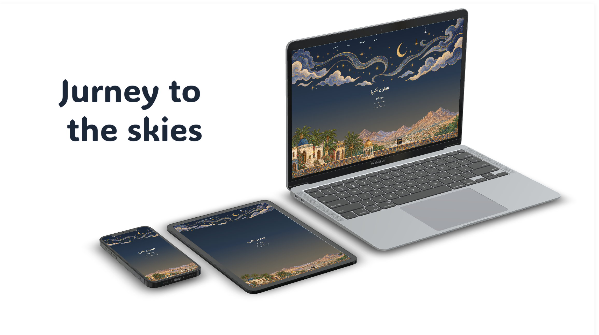

# 🌙 رحلة إلى السماء

موقع ويب عربي تعليمي عن **الصلوات المكتوبة**، مستوحى من أجواء ليلة الإسراء والمعراج، مع تصميم بصري يجمع بين الفن الإسلامي والسماء والنجوم.

## ✨ فكرة المشروع

يقدم الموقع معلومات مبسطة عن الصلوات الخمس، وكيف فُرضت، وعدد ركعات كل صلاة، مع تصميم عربي متجاوب مع مختلف أحجام الشاشات.

## 🎨 أقسام الموقع

### 🏠 البداية

قسم Hero يحتوي على:

* عنوان الموقع: **الصلوات المكتوبة**
* عبارة **رحلة إلى السماء**
* خلفية سماوية متحركة
* زر للانتقال إلى قسم المعلومات

### 🕌 كيف فرضت؟

يعرض قصة فرض الصلاة والإسراء والمعراج، مع صورة للمسجد الأقصى.

### 🕋 الصلوات الخمس

بطاقات تعريفية للصلوات:

* صلاة الفجر
* صلاة الظهر
* صلاة العصر
* صلاة المغرب
* صلاة العشاء

وتحتوي كل بطاقة على عدد الركعات وبعض المعلومات الأساسية عن وقت الصلاة والسنن الرواتب.

### 📩 تواصل معنا

نموذج للتواصل يحتوي على:

* الاسم
* البريد الإلكتروني
* الرسالة
* زر إرسال

### 🔗 Footer

يحتوي على روابط لأيقونات:

* Instagram
* X
* LinkedIn
* البريد الإلكتروني

---

## 🛠️ التقنيات المستخدمة

* **HTML5**
* **CSS3**
* **JavaScript**
* CSS Grid
* CSS Flexbox
* Responsive Design
* CSS Animations / Parallax
* Font Awesome
* Google Fonts

### 🔤 الخطوط

يستخدم الموقع خطوطًا عربية من Google Fonts:

* Aref Ruqaa
* Amiri
* Noto Sans Arabic

---

## 📁 هيكل المشروع

```text
project/
│
├── index.html
│
├── css/
│   └── style.css
│
├── javascript/
│   └── main.js
│
├── images/
│   ├── logo.png
│   ├── sky.png
│   ├── web.png
│   ├── web2.png
│   ├── aqsa.png
│   └── card-frame.png
│
└── README.md
```

## ⚙️ JavaScript

يستخدم JavaScript للتحكم في القائمة على الهاتف وإضافة تأثير **Parallax** لخلفية قسم البداية.

```js
const menuBtn = document.querySelector(".menu-btn");
const nav = document.querySelector("nav");

menuBtn.addEventListener("click", () => {
    nav.classList.toggle("active");
});

document.querySelectorAll("nav a").forEach(link => {
    link.addEventListener("click", () => {
        nav.classList.remove("active");
    });
});
```

كما تتحرك طبقات السماء بسرعات مختلفة أثناء التمرير:

```js
window.addEventListener("scroll", () => {
    const scroll = window.scrollY;

    sky.style.transform =
        `translate(-50%, ${scroll * 0.6}px)`;

    web.style.transform =
        `translate(-50%, ${scroll * 0.2}px)`;
});
```

## 📱 Responsive Design

عند الوصول إلى شاشة بعرض أقل من `768px`:

* تتحول القائمة إلى قائمة هاتف.
* تظهر أيقونة القائمة.
* تتحول أقسام Grid إلى عمود واحد.
* يتم تكبير صور الـ Hero للحفاظ على التأثير البصري.



## 🚀 تشغيل المشروع

لا يحتاج المشروع إلى إعدادات معقدة.

1. قم بتحميل المشروع.
2. تأكد من وجود مجلد `images`.
3. افتح `index.html` في المتصفح.

يفضل استخدام **Live Server** أثناء التطوير للحصول على تجربة أفضل.

### Live Link 

[Live Link](https://github.com/mada-coding-challenge/mada-alwuthainani-unit3)
